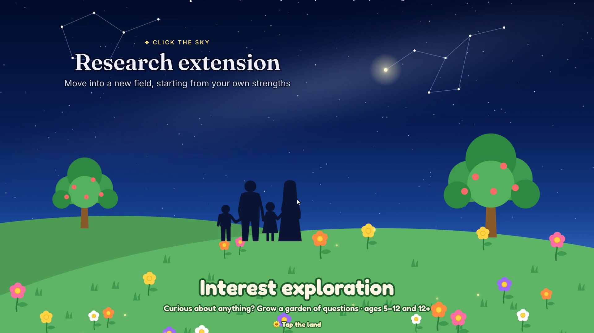
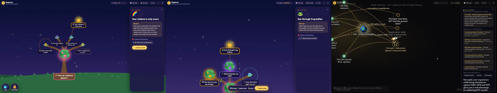

# Miror

Miror, ergo cogito, ergo sum. (I wonder, therefore I think, therefore I am.)

(*Late) Birthday present to Ming, the cousin never runs out of questions. Let curiosity spark learning again.

**Miror turns "I wonder…" into a map that grows.** Instead of waiting for you to know what to ask, it asks you first, then builds a knowledge map that lights up as you explore. Kids follow their own interests; researchers stepping into a new field start from the strengths they already have.

**Live:** https://explorer-mindflow.netlify.app (best in Chrome on a laptop).



## What it does

**Interest exploration: interest first** (ages 5–12, and 12+)

No background check and no right answers to chase: everything starts from what the child loves and wonders about.

- No tests: just your age, what you love and what you wonder about. Each answer digs, waters and plants a seed; the tree or flower garden grows once you're done.
- Every question starts with an "Imagine…" moment from everyday life, then one playful choice.
- **Ask your own question** with the watering can (typed or spoken in Chrome): it grows on the branch where it fits best.
- **Fun-fact fertilizer:** a true 1–3 sentence fact tied to what you love grows as a golden fruit on the most relevant branch.
- **Our land:** a family, class or friend group shares gardens with a 6-letter code. Nickname only, opt-in sharing, text only.

**Research extension: find your strengths**

Not just what you lack in a new field, but what you already bring to it.

- Your level, expertise, skills and hobbies, target field and (optionally) papers or notes build a spaceship, which launches into your map.
- **Your path:** what to focus on first, what to skip for now, and which of your strengths will help most.
- The first questions cover the field's **principles** and **applications**, plus a gold **interlink** star that lists the strengths you bring and draws lines from everything you already know into the new field.
- Bridges and analogies back to your own skills, quick checks, claimable strengths, and your own questions, launched like comets.



## How it works

```
Browser (demo/: HTML, CSS, JS + D3 v7, no build step)
   │  POST /api/map · /api/expand · /api/ask · /api/fact · /api/group · /api/check-key   GET /api/health
   ▼
Local: server.mjs (port 8787)          Hosted: netlify/functions/*.mjs (same logic)
   ▼
api/explorer-ai.mjs → Claude Haiku 5.5, structured JSON output only
api/groups.mjs      → group lands (JSON files locally, Netlify Blobs when hosted)
```

- **The AI writes words; the visuals are designed.** Every model call returns text in a fixed schema (Zod + structured outputs). All scenes, animations and map layouts are pre-built in the front end, so maps always look right and cost under a cent.
- **Maps grow one layer at a time** (up to 6), with the next layer prepared while you read.
- **Robust by default:** odd labels fall back to safe values, empty layers are asked again once, and near-duplicate questions are dropped.
- **Keys stay private.** The API key lives only on the server (`.env` locally, an environment variable when hosted). Researchers can optionally use their own key in ⚙ Settings; it stays in their browser and is sent straight to Anthropic.

## Run it locally

Requires Node 22+ and an Anthropic API key.

```bash
npm install
echo "ANTHROPIC_API_KEY=your-key-here" > .env
npm start            # then open http://localhost:8787
```

On a Mac you can also double-click `Start Miror.command`. Without a key, the sample maps and built-in answers still work. Deploying to Netlify is covered in [How_to_run.md](How_to_run.md).

## Repository map

| Path | What it holds |
|---|---|
| `demo/` | The whole front end: `app.js` (wiring), `graph.js` (the D3 map), `scene.js` (opening picture and journeys), `intake.js`, `group.js` (Our land), `data/` (sample maps) |
| `api/` | AI logic (`explorer-ai.mjs`), group lands (`groups.mjs`), shared HTTP helpers |
| `server.mjs` · `netlify/functions/` | The same API, locally and on Netlify |
| `Guidance/` | Project brief, status, technical guide and next steps; `tools/` holds browser tests, the scripts that record the demo clips (`make-videos.js`) and the one that fits them to a voice-over (`make-final.js`) |
| `Writeup/` | The hackathon write-up (short plain-text version and a longer one) and its figures |
| `samples/` | Screenshots and recorded sample runs |

## Next steps

Real citations and a "please verify" label · feeding new papers into an existing map · collaborator view and team maps · duplicate detection by meaning · streaming maps · moderation tools for shared lands.

---

Built for the OSI Hackathon 2026 with [Claude Code](https://claude.com/claude-code). AI-generated content can be wrong: please verify important details.
